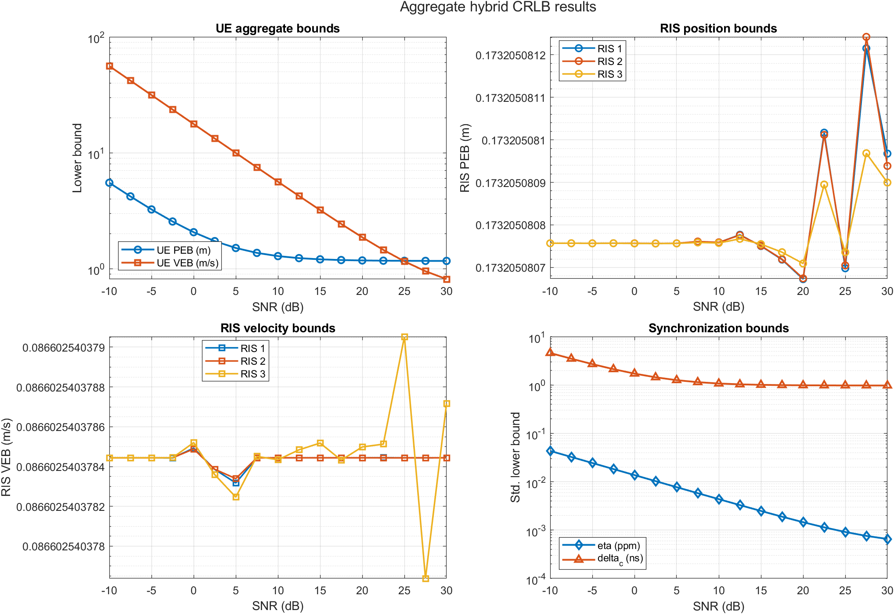
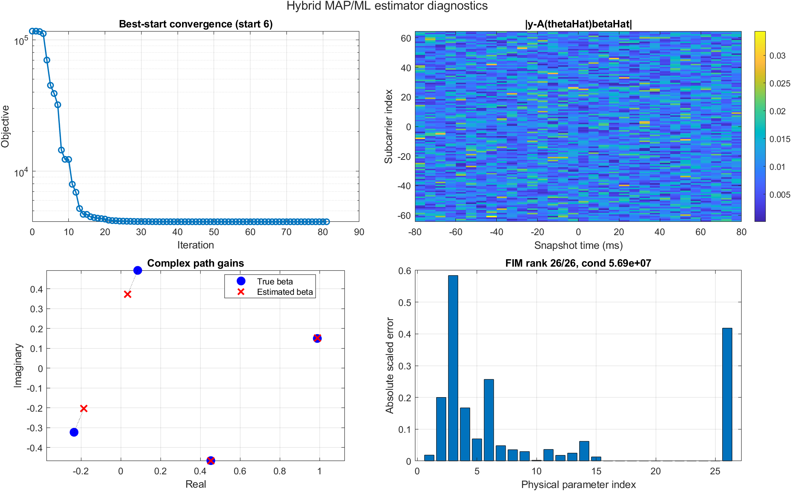

# RIS-Aided Localization and Synchronization under Uncertain RIS Geometry

**B.Sc. project — Department of Electrical Engineering, Sharif University of Technology**
Mohammad Amin Khoshkam · Supervisor: Dr. Rouhollah Amiri · Bahman 1404 (Winter 2026)

📄 **[Project report (PDF)](report/RIS_Localization_Report_EN.pdf)**

---

Reconfigurable intelligent surfaces (RISs) can act as extra geometric anchors for localization — but only if
we know where they are. In practice, installation, surveying and calibration errors mean the RIS position (and
even its motion) is only approximately known. This project builds that uncertainty **directly into the model,
the bound and the estimator**, instead of assuming perfectly known RISs.

We jointly estimate, from OFDM pilots sent over $N$ subcarriers and $L$ time snapshots:

- the 3-D **position and velocity** of a mobile user (UE),
- the **relative frequency error** $\eta$ and the **clock offset** $\delta_c$,
- the **positions and velocities of the RISs** (with a Gaussian prior), and
- the **complex path gains** of the direct path and the RIS paths.

## What's in this project

| Part | Method |
|---|---|
| Signal model | Discrete OFDM model where delay, Doppler, frequency error and clock offset are merged into one **effective delay** $a_{l,k}=\tau_{l,k}-(\nu_{l,k}-\eta)T_l-\delta_c$; observations $\mathbf{y}=\mathbf{A}(\boldsymbol\theta)\boldsymbol\beta+\mathbf{z}$ |
| Fundamental limit | **Hybrid Fisher information** (data + RIS prior only), channel gains removed as nuisance parameters with a **Schur complement** → PEB, VEB and synchronization bounds; rank and condition-number analysis |
| Estimator | **Hybrid MAP/ML**: MAP for the RIS states, ML for UE/synchronization/channel; gains eliminated by **variable projection**; coarse-to-fine grid over $(\eta,\delta_c)$, random **multi-start** and constrained **SQP** (`fmincon`) |

## Key results (3 RISs, SNR = 20 dB)

**Hybrid bound** ([`crlb/crlb_results/summary_bounds.csv`](crlb/crlb_results/summary_bounds.csv))

| Quantity | Lower bound |
|---|---|
| UE position error bound (PEB) | 1.176 m |
| UE velocity error bound (VEB) | 1.864 m/s |
| Relative frequency error $\eta$ | 0.00146 ppm |
| Clock offset $\delta_c$ | 0.985 ns |
| Each RIS position / velocity | 0.173 m / 0.087 m/s (= $\sqrt{3}\sigma_p$, $\sqrt{3}\sigma_v$ — prior-dominated) |

**Hybrid MAP/ML estimator, one noise realization** ([`estimator/hybrid_map_results/summary.csv`](estimator/hybrid_map_results/summary.csv))

| Metric | Value |
|---|---|
| UE position error | 3.212 m (initial) → **0.617 m** |
| $\eta$ / $\delta_c$ absolute error | 0.000136 ppm / 0.418 ns |
| Normalized data cost | 0.999 per sample (consistent with the noise model) |
| Multi-start | all 8 starts reach the same final cost |
| Local FIM | rank 26/26, condition number $5.7\times10^{7}$ |

**Main findings**

- **The RIS prior is part of the error budget.** Increasing the RIS position prior std from 0.02 m to 0.5 m
  raises the UE PEB almost linearly from 0.29 m to 5.82 m.
- **Full rank is not enough.** The FIM is full rank, but its condition number is ~10⁷–10⁸; the **vertical**
  UE position/velocity is the weakest direction (per-axis position bounds 0.12 / 0.15 / 1.16 m).
- Position-type bounds hit an **error floor** (~1.16 m) at high SNR, while velocity and frequency-error bounds keep
  improving thanks to time diversity across snapshots.

<p align="center">
  <br>
  <em>Aggregate hybrid bounds versus SNR.</em>
</p>
<p align="center">
  <br>
  <em>Estimator diagnostics: convergence, residual map, path gains and parameter errors.</em>
</p>

**Known limitations** (discussed in the report): constant-velocity motion, ICI neglected, constant path gains
over the block, the bound and estimator scenarios use slightly different geometries, the estimator is evaluated on
a single noise realization (no Monte Carlo RMSE yet), and in the saved run the local search box was active for
$u_y$ (estimate 9.8 m vs. true 10 m).

## Repository layout

```
crlb/                         Hybrid CRLB package
  main.m                      ← run this
  create_crlb_config.m        scenario and simulation settings
  simulate_all_crlb_bounds.m  FIM, Schur complement, SNR sweep
  analyze_ris_prior.m         sensitivity to the RIS prior
  plot_*.m, build_result_tables.m, save_crlb_outputs.m
  crlb_results/               CSV tables, figures (01–08) and crlb_results.mat

estimator/                    Hybrid MAP/ML estimator package
  main_ris_hybrid_estimator.m ← run this
  ris_estimator_config.m      scenario, prior, bounds and optimizer settings
  ris_estimate_hybrid_map.m   multi-start constrained optimization
  ris_hybrid_map_cost.m       concentrated (variable-projection) cost and gradient
  ris_coarse_sync_search.m    coarse-to-fine search over (eta, delta_c)
  ris_*.m                     model, Jacobian, diagnostics, tables, plots
  hybrid_map_results/         CSV tables, figures and hybrid_map_estimate.mat

report/
  RIS_Localization_Report_EN.pdf / .tex       project report (LaTeX source included)
```

## Running the code

Requires MATLAB (tested with **R2024a**). The estimator uses `fmincon` from the **Optimization Toolbox** when it
is available and falls back to a penalized `fminsearch` otherwise.

```matlab
% Hybrid CRLB (writes crlb/crlb_results/)
cd crlb
main

% Hybrid MAP/ML estimator (writes estimator/hybrid_map_results/, ~1.5 min)
cd ../estimator
main_ris_hybrid_estimator
```

Both scripts use a fixed random seed (42). Re-running them with MATLAB R2024a reproduces the CSV files in this
repository exactly. All settings (geometry, SNR, prior standard deviations, optimizer options) are in
`create_crlb_config.m` and `ris_estimator_config.m`.

## Citation

```bibtex
@thesis{khoshkam2026ris,
  author = {Mohammad Amin Khoshkam},
  title  = {Localization and Synchronization of a Mobile User Aided by Reconfigurable
            Intelligent Surfaces with Uncertain Positions},
  type   = {B.Sc. project report},
  school = {Sharif University of Technology, Department of Electrical Engineering},
  year   = {2026}
}
```
